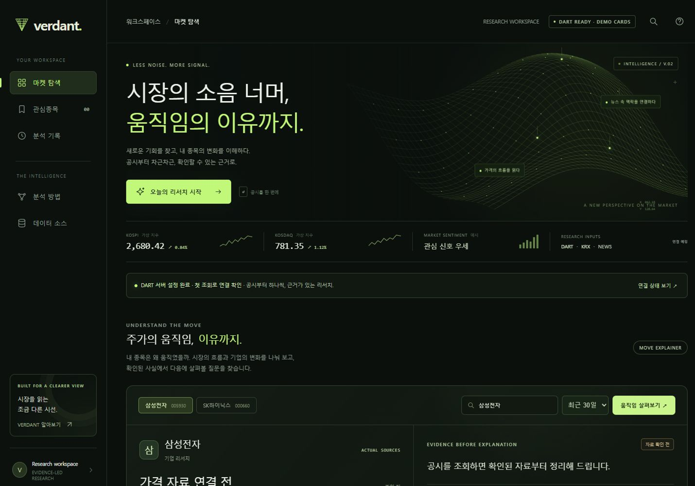
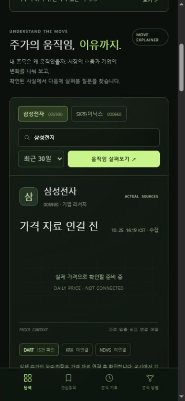
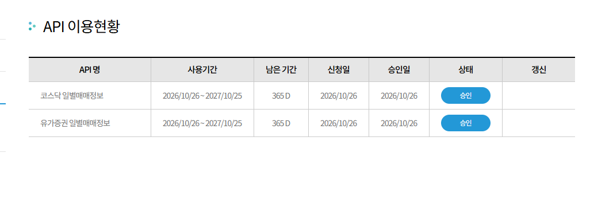

# VERDANT

**Beyond the noise. — 시장의 소음 너머, 움직임의 이유까지.**

공시에서 시작하는 국내 주식 리서치 대시보드입니다. 딥 포레스트·라임 디자인, 움직이는 와이어프레임, 버튼으로 시작하는 공시 조회와 종목 리서치를 제공합니다.

[웹 버전](https://verdant-market-taeo.rlaxodh5.chatgpt.site) · 소유자 전용 접근

## 화면

### 데스크톱



### 모바일 · 실제 DART 조회 후



[실제 조회 결과의 추가 화면](docs/images/verdant-actual-dart.jpg)

## 현재 기능

- 실제 DART 기업 목록으로 기업명·종목코드·고유번호 연결
- 기업별 최근 7·30·90일 공시와 코스피·코스닥 최근 공시 조회
- 접수번호·원문 링크·접수일·수집 시각, 정정공시 및 제목 유형 표시
- 실제 서버 작업 단계 표시, 취소·오류·빈 결과·부분 수집 처리
- 최근 5개 표시 리포트의 브라우저 저장, 당시 결과 재열기, JSON 내보내기
- 시장·업종 / 기업 공시 / 뉴스 시점으로 나누는 주가 움직임 분석 화면
- 단타·장기 후보, 업종 필터, 관심종목, 상세 리포트의 **가상 데모**
- 데스크톱·모바일 레이아웃과 `prefers-reduced-motion` 지원

## 실제 데이터와 데모의 구분

| 항목 | 상태 |
| --- | --- |
| DART 공시 조회 | PC 실행에서 실제 동작 |
| 공시 본문·재무 수치 분석 | 후속 개발 필요 |
| KRX 가격·거래량 | 코스피·코스닥 일별매매정보 실제 연결 완료 · 최근 최대 5거래일 |
| 뉴스 | 공급원 선정·연결 예정 |
| 후보 카드·지수·가격·기사·점수 | 가상 데모 |
| 실제 상승 후보 선정·가격 변동 원인 판단 | 가격·뉴스 연결 및 검증 필요 |

현재 Cloudflare 실행 환경에서는 DART 도메인 요청이 네트워크 오류로 실패합니다. PC에서는 실제 공시와 KRX 가격을 함께 조회할 수 있습니다. 클라우드 연결 문제 해결 전에는 PC 실행 버전을 이용합니다. KRX는 전일까지의 자료에서 최근 최대 5거래일을 조회하며 비수정 종가·전일 대비 등락률·거래량·거래대금·기준일을 제공합니다. 실시간 현재가나 전체 30·90일 수익률을 의미하지 않습니다. 뉴스·업종 비교가 없어 가격 변동 원인은 확정하지 않습니다.

## PC 실행

Node.js가 필요합니다. 기존 Codex PC 환경에서는 **`VERDANT 실행.cmd`를 더블클릭**하면 됩니다. 실행 파일은 현재 사용자 폴더의 Codex Node 런타임을 사용합니다.

다른 Node.js 환경에서는 저장소 폴더에서 다음과 같이 실행합니다. 이 로컬 서버는 별도의 패키지 설치 없이 Node 기본 모듈을 사용합니다.

```powershell
node scripts/local-dashboard.mjs
```

브라우저에서 [http://127.0.0.1:5177](http://127.0.0.1:5177)을 엽니다. 현재 로컬 서버는 **저장소의 상위 폴더에 있는 `DART API.txt`**를 읽습니다. 발급받은 40자리 키만 넣고, 키 파일을 Git에 올리지 마세요. 서버는 PC 내부 주소에만 바인딩하며, 키를 브라우저로 전달하지 않습니다.

## 웹 서버 개발

Node.js 22.13 이상에서 실행합니다.

```powershell
npm run install:ci
npm run dev
```

PC 실행은 상위 폴더의 `KRX API.txt`(또는 `KPX API.txt`)를 추가로 읽습니다. KRX 키는 요청 헤더 `AUTH_KEY`로만 전달합니다. 인증키 발급 외에 ‘유가증권 일별매매정보’와 ‘코스닥 일별매매정보’의 각각의 이용 승인이 필요합니다.

로컬 웹 개발에서는 `.dev.vars`에 `DART_API_KEY`, `KRX_API_KEY`를 설정하고 운영 환경에서는 같은 이름의 서버 secret을 사용합니다. `.openai/hosting.json`은 기존 Sites 배포 식별자를 보존합니다. 키와 로컬 환경 파일, 의존성, 빌드 결과는 저장소에서 제외됩니다.

## 검증

```powershell
node --test tests/research.test.mjs tests/krx.test.mjs
npm run build
```

- 단위 테스트 10개 통과: DART 6개 + KRX 숫자 정규화·권한 오류·과거 날짜 순회·통신 오류 4개
- 프로덕션 빌드 통과
- PC 실제 API 검사: 삼성전자 최근 30일 15건, SK하이닉스 4건 (2026-10-25 기준)
- 데스크톱·390px 모바일 브라우저에서 삼성전자 실제 조회 확인
- 2026-10-26: 두 KRX API 실제 HTTP 200, 삼성전자·SK하이닉스·JYP Ent.의 최근 5거래일 자료 확인. KRX 화면 변경 후의 브라우저 시각 검사는 접근 정책 때문에 수행하지 못했습니다.

### KRX API 승인 기록



## 주요 파일

| 경로 | 용도 |
| --- | --- |
| `web/index.html` | 기존 목업을 바탕으로 한 화면 |
| `public/refined.css`, `public/refined.js` | 디자인·모션·실제 조회·기록 |
| `lib/market-research.mjs` | DART 수집·기업 매핑·공시 유형 분류 |
| `scripts/local-dashboard.mjs` | PC용 로컬 서버 |
| `app/api/` | 웹 서버의 연결 상태·공시 조회 API |
| `docs/images/` | 데스크톱·모바일·조회 화면 이미지 |
| [IMPLEMENTATION.md](IMPLEMENTATION.md) | 현재 구현과 제약 |
| [docs/RESEARCH.md](docs/RESEARCH.md) | 초기 조사와 공식 출처 |
| [CODEX_HANDOFF.md](CODEX_HANDOFF.md) | 원본 목업 인수인계 기록 |

PC 버전과 웹 버전의 브라우저 저장 기록은 자동 동기화되지 않습니다.

## 종합 리서치와 뉴스 연결

핵심 결론 → 단타(1–5거래일) / 장기(6–12개월) → 핵심 공시 → 원문 목록 순서로 제공합니다. 단타는 최대 5개 종가와 거래량, 장기는 DART 전년 동기 실적·현금흐름에 근거한 규칙 기반 관찰입니다. 공시 정리는 제목의 유형과 확인 항목이며 본문 전체 분석이 아닙니다.

뉴스는 https://guide.ncloud-docs.com/docs/apihub-application 에서 NAVER 검색의 뉴스 상품을 신청하고 이용 한도를 설정합니다. Client ID와 Client Secret은 채팅에 보내지 말고 실행 바로가기와 같은 위치의 NEWS API.json에 저장합니다. 서버 재시작 시 읽습니다. 해당 파일은 Git에서 제외합니다.

```json
{"clientId":"발급한 Client ID","clientSecret":"발급한 Client Secret"}
```

배포 환경변수: NAVER_NEWS_CLIENT_ID, NAVER_NEWS_CLIENT_SECRET. 제목·검색 요약·원문 링크만 수집하며 기사 본문 검증이나 가격과의 인과 분석은 수행하지 않습니다. 검증: node --test tests/research.test.mjs tests/krx.test.mjs tests/brief.test.mjs (15개 통과).

## 후보 탐색 중심 흐름 (2026-10-26)

첫 화면의 `단타·장기 후보 찾기`는 KRX 코스피·코스닥 최근 일별 자료에서 거래대금 100억원 이상 상위 24개를 심사합니다. 단타는 종가 상승·거래량, 장기는 전년 동기 매출·영업이익 성장과 영업현금흐름으로 각각 순위를 매겨 최대 4개씩 표시합니다. 두 목록은 중복 제외하며 자금조달·소송 등 제목 위험 공시는 제외합니다. 시장 공시 수집이 부분적이면 위험 검토에도 누락이 있을 수 있습니다.

카드를 클릭하면 선택한 전략의 기업 상세 분석, 뉴스·공시, 보수/기준/낙관 가격 시나리오가 열립니다. 예상 수익성은 백테스트 전 민감도 가정값입니다. 단타는 최근 4개 일별 로그수익률 평균의 5일 연장(±8% 제한), 장기는 영업이익 성장률의 1/4(±30% 제한, 평가배수·주식수 불변)을 기준으로 합니다. 장기 상하 20%p, 단타는 관측 변동성 기반 폭을 적용합니다. 통계적 기대수익률·확률이나 보장 수익률로 해석하면 안 됩니다. 배당·수수료·세금·기업행동 미반영, 뉴스는 상세 진입 시 조회하고 순위에는 미반영입니다.

테스트 19개: `node --test tests/research.test.mjs tests/krx.test.mjs tests/brief.test.mjs tests/selection.test.mjs`. 실제 2,764개 시세에서 24개 재무 검토 및 후보 생성 요청이 완료됐습니다.
